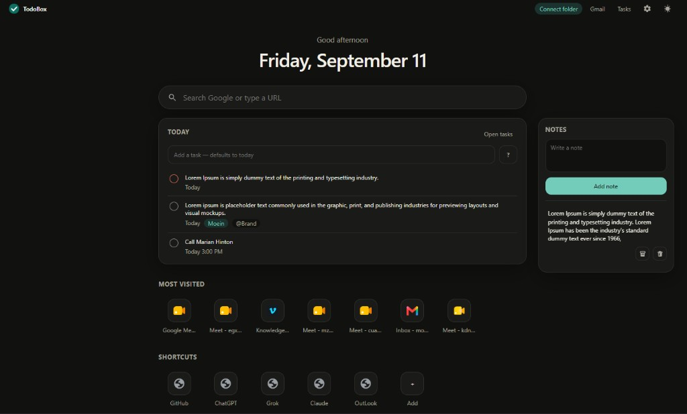
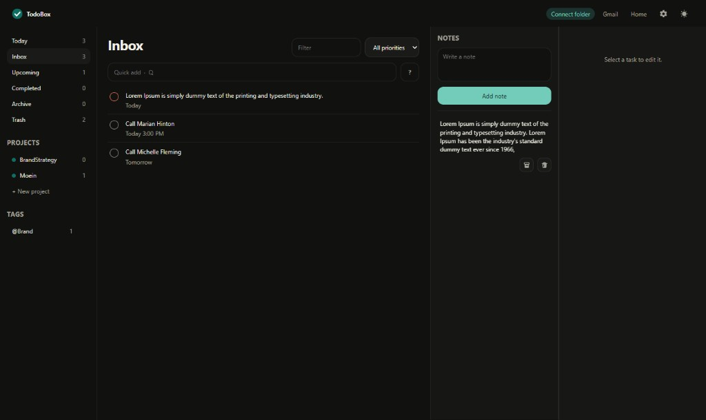
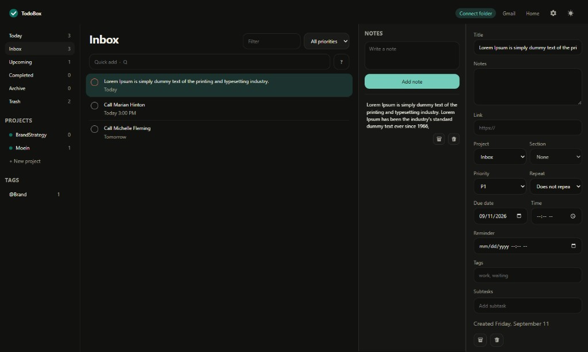

# TodoBox

A calm Chrome new-tab homepage with Google search, shortcuts, most-visited sites, notes, and a full local task manager.

Author: [Moein Mollaee](https://moeinmollaee.com)

Version **1.1.1**. Tasks, notes, projects, and shortcuts live in a SQLite file you choose (`todobox.sqlite`). Mail over **IMAP + SMTP** works through a **local mail bridge** on your PC — passwords stay in `%LOCALAPPDATA%\TodoBox`, not in the cloud sync file.

## Demo

New tab home — search, today’s tasks, notes, most visited, and shortcuts:

Task workspace — Inbox, projects, tags, and notes side by side:

Task detail — title, notes, due date, priority, tags, reminders, and subtasks:

## What you get

- New-tab home: greeting, Google search, Today list, shortcuts, notes
- Tasks: Inbox, Today, Upcoming, Completed, Archive, Trash
- Projects with optional board/sections, tags (`@later`), priorities P1–P4
- Recurring tasks, due dates/times, reminders with optional notification sound
- Subtasks, task links, undo (`Ctrl+Z`)
- Light / dark / system theme
- Chrome toolbar popup for today’s tasks
- **Mail:** multi-account IMAP/SMTP (folders, read, compose/reply/forward, attachments, move/delete)
- Optional Windows PWA + local server (same database; also runs the mail bridge)
- Folder file you can put in Google Drive, OneDrive, or Dropbox so two computers merge the same database

Most visited sites are Chrome-only. They are hidden in the PWA.

### Mail (IMAP / SMTP)

Chrome cannot speak IMAP/SMTP by itself. TodoBox uses the local server from **`app install`**:

1. Run **`app install\run.bat`** (or the tray app) so `http://127.0.0.1:8080` is up
2. Open TodoBox → **Mail** → **Add account**
3. Enter mailbox email/password plus IMAP and SMTP server settings (often `mail.yourdomain.com`, ports 993 and 465)

Accounts and passwords are stored only on this computer. Reload the unpacked extension after upgrading so `host_permissions` for localhost apply.

## Privacy

TodoBox does not send your tasks anywhere. Data stays in:

1. The browser (until you connect a folder)
2. `todobox.sqlite` in a folder you pick (recommended)

The extension asks for local Chrome APIs (storage, notifications, alarms, top sites, favicons, offscreen audio) plus localhost access for the optional mail bridge (`127.0.0.1:8080`). It has no remote host permissions and no analytics.

Your public author credit (name and website) is the only personal identity in this repository. Do not commit `todobox.sqlite`, `.env`, or `app install/pwa-settings.ini`.

## Install (Chrome extension)

Requires [Node.js](https://nodejs.org/) once, then Chrome 116+.

1. Run **`install.bat`** (installs dependencies and copies `vendor/`)
2. Open `chrome://extensions`
3. Turn on **Developer mode**
4. Click **Load unpacked**
5. Select this project folder

New tabs open TodoBox. In Chrome settings, set **On startup** to **Open the New Tab page** if you also want it as the home screen.

## PWA (standalone web app)

No Chrome extension required. From the **`app install`** folder:

1. Run **`install.bat`** once
2. Run **`run.bat`** — first time you choose: **Windows startup** or **manual**
3. Optional: **Install TodoBox** from the browser menu to pin it like a desktop app

Change startup later: **`app install\startup-settings.bat`**. Stop the background server: **`stop-server.bat`**.

Copy the whole project folder to another PC and repeat. Use the same `todobox.sqlite` folder as the extension so both share one database.

## Connect a folder (recommended)

1. Click **Connect folder** (or Settings → **Choose folder**)
2. Pick a folder you control
3. TodoBox writes **`todobox.sqlite`** there

If that folder already has a file and this browser also has tasks, choose:

- **Merge** — keep items from both sides (recommended)
- **Load folder file** — replace this browser with the file
- **Keep current** — overwrite the file with this browser

Chrome may ask you to reconnect the folder after a restart. Use **Reconnect folder** when you see it.

### Sync with Google Drive, OneDrive, or Dropbox

TodoBox has no built-in cloud account. It syncs if `todobox.sqlite` sits in a folder your cloud client already keeps in sync.

1. Create a folder inside Google Drive, OneDrive, or Dropbox (for example `TodoBox`)
2. Wait until that folder exists as a normal folder on disk
3. In TodoBox, **Connect folder** and select it
4. On another computer, install TodoBox, wait for the same folder to sync, then connect it and choose **Merge** (or **Load folder file** if this browser is empty)

When both devices have tasks, TodoBox **merges** them: new items from each side are kept. If the same task is edited on both devices before the file syncs, the later save wins. The app also re-reads the folder when you come back to the tab, and about every 15 seconds while it is open.

Tips:

- After switching computers, wait until the cloud client finishes uploading/downloading before you work (or wait a few seconds in TodoBox).
- On OneDrive, keep `todobox.sqlite` **available offline** (not Files On-Demand only).
- Appearance (theme) is stored in the database file and syncs with it. Notification sound stays on that browser only.

### Backup without a cloud folder

- **Export backup** in Settings downloads a dated copy such as `todobox-2026-09-06-023000.sqlite`
- **Import** loads a `.sqlite` / `.db` file into the app

Copying `todobox.sqlite` yourself works the same way.

## Quick add

Examples:

- `Email Sara tomorrow 5pm p1`
- `Pay rent every month #Home`
- `Read article @later`

Phrases: today, tomorrow, tonight, monday, 5pm, every day, every weekday, every week, every month, every year, every 3 days, p1, #Project, @tag.

On Home, a task with no date is due today. In the task list, a task with no date stays in Inbox (except on the Today view).

Click **?** next to the add field for the phrase list.

## Keyboard

| Key | Action |
| --- | --- |
| `Q` | Quick add |
| `/` | Filter tasks |
| `Esc` | Close panels / go home |
| `Ctrl+Z` | Undo |
| `1`–`4` | Priority of the selected task |
| `D` | Complete the selected task |
